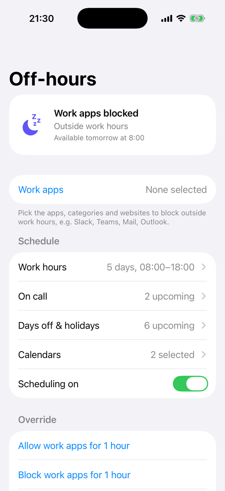
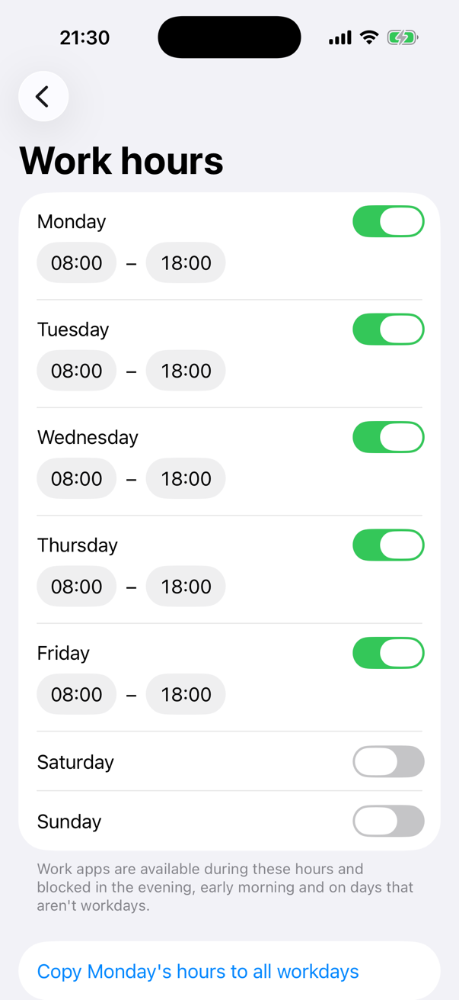
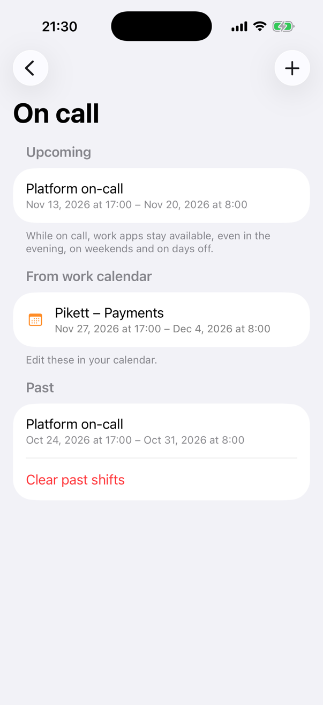
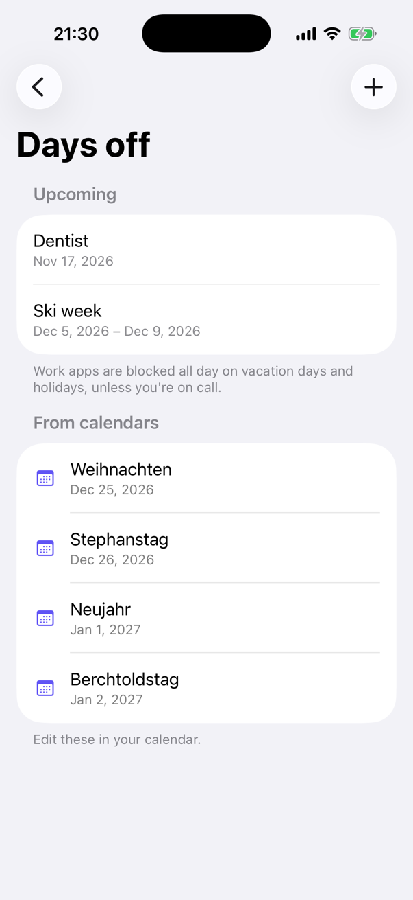
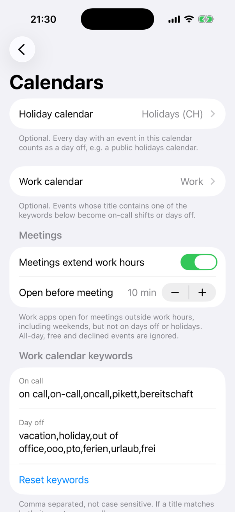

# Off-hours

> [!IMPORTANT]
> **This entire repository, including the application, design, tests, documentation, and deployment setup was made with AI.**

Off-hours is a small iPhone app that uses Screen Time to block your work apps when you are not working:
in the evening, early in the morning, at weekends, on vacation and on public holidays. When you are on call,
or have a meeting outside work hours, the work apps open again on their own. It is written in Swift and
SwiftUI, has no server and no account, and nothing leaves the device.

## Screenshots

| Status | Work hours | On call |
| --- | --- | --- |
|  |  |  |
| **Days off & holidays** | **Calendars** | |
|  |  | |

The screenshots show fictional data (`-demo`, see [Development](#development)). The simulator cannot pick apps
through Screen Time, so "Work apps" is empty there.

## Features

- **Work apps**: pick apps, whole categories and websites with Apple's Screen Time picker; they are shielded
  while blocked.
- **Work hours** per weekday. Outside them (evenings, early mornings) and on days that aren't workdays, work
  apps are blocked.
- **On call**: shifts with a start and end (quick lengths for tonight, a day, a weekend or a week). While on
  call, work apps stay available, also in the evening, at weekends and on days off.
- **Days off & holidays**: single days or ranges on which work apps are blocked all day.
- **Calendars** (both optional):
  - a **holiday calendar**, e.g. a subscribed public holidays calendar: every day with an event is a day off;
  - a **work calendar**: events whose title contains an on-call keyword (`on call`, `pikett`, `bereitschaft`, …)
    become on-call shifts, events with a day-off keyword (`vacation`, `ooo`, `ferien`, …) become days off.
    Both keyword lists can be edited.
- **Meetings extend work hours** (optional): timed, busy, accepted work-calendar events outside work hours
  open the work apps from a few minutes before (10 by default) until they end, also at weekends, but not on
  days off or holidays.
- **Overrides**: allow or block work apps for an hour, or flip the current state until the next scheduled
  change. An override beats every rule.
- **Status** on the main screen: blocked or available, why, and when that changes next.
- **Works with the app closed**: a DeviceActivity monitor extension is woken by the system at every change
  and applies the block, and re-reads the calendars once a day.

## How it decides

The first rule that applies wins:

1. Scheduling turned off → available
2. Override → as chosen, until it ends
3. On-call shift (by hand or from the work calendar) → available
4. Day off or holiday (by hand or from a calendar) → blocked all day
5. Meeting from the work calendar → available from the buffer before it until it ends
6. Not a workday → blocked all day
7. Work hours → available inside, blocked outside

The rules live in `Shared/Model/Policy.swift` and are covered by unit tests.

## How it works

Screen Time can only wake an app extension at the start or end of a scheduled interval. Off-hours therefore
works out the next ten moments at which the decision changes and registers a short interval that starts at
each of them, plus a daily one after midnight as a safety net. Whenever the extension is woken, it applies or
removes the shield (`ManagedSettingsStore`) and schedules the next batch. The app and the extension share their
settings through an app group.

Calendars are read with EventKit for the next 60 days, by the app when it opens, comes back to the foreground
or the calendar changes, and by the extension once a day. Imported entries are kept apart from the ones you
added by hand and are replaced on every sync.

## Requirements

- macOS with Xcode 26 or newer
- Node.js and npm (command runner only; there are no npm dependencies)
- [XcodeGen](https://github.com/yonaskolb/XcodeGen): `brew install xcodegen`
- An iPhone with iOS 17 or newer. Screen Time blocking does not work in the simulator.
- A paid Apple Developer account. The Family Controls (Development) capability is enough to run the app on
  your own devices; TestFlight and the App Store need Apple to approve the Family Controls (Distribution)
  entitlement.

## Development

Copy `.env.example` to the ignored `.env` and set `IOS_DEVELOPMENT_TEAM` (and `IOS_DEVICE_ID` for
`npm run deploy`). Project generation applies the team every time, so regenerating `OffHours.xcodeproj` does not
lose it.

```sh
npm run ios           # generate the project and open it in Xcode
npm test              # unit tests with code coverage in the iPhone simulator
npm run test:unit     # unit tests only
npm run build         # unsigned Release build
npm run ios:release   # signed Release build (registers IDs and capabilities)
npm run deploy        # signed Release build installed and launched on IOS_DEVICE_ID
npm run upload        # archive and upload to App Store Connect (needs the Family Controls distribution entitlement)
npm run lint && npm run format:check
npm run format        # swift-format in place
```

`OffHours.xcodeproj` is generated from the tracked `project.yml`; change settings there and regenerate instead
of editing the project.

Debug builds launched with `-demo` (Xcode: Edit Scheme → Run → Arguments) show fictional work hours, on-call
shifts, days off, calendars and meetings. Nothing is saved or enforced in that mode and no calendars are read.

## Testing

The XCTest suite covers the decision rules (work hours, weekends, days off, on call, meetings with their
buffer, overrides, turning scheduling off), the computed change times the extension is woken at, the calendar
import (holiday and work calendars, keywords, all-day events and their end at midnight, free and declined
events, meetings inside work hours, deterministic IDs) and loading settings saved by older versions.

CI runs on Gitea Actions (`.gitea/workflows/ci.yml`) on a macOS runner: format check, lint and an unsigned
Release build, then the unit tests; builds on `main` are kept as an artifact for 30 days.

## Architecture

```
OffHours/            the app: AppModel (settings, Screen Time and calendar access), SwiftUI views, demo data
OffHoursMonitor/     DeviceActivity monitor extension, woken at every change and once a day
Shared/
  Model/             Config, Policy (the rules and the change times), CalendarImport (events → shifts, days off,
                     meetings); plain Foundation, unit tested
  Enforcement/       SharedStore (app group), Enforcer (shield + DeviceActivity schedule), CalendarSync (EventKit)
OffHoursTests/       unit tests
```

## License

MIT, see [LICENSE](LICENSE).
